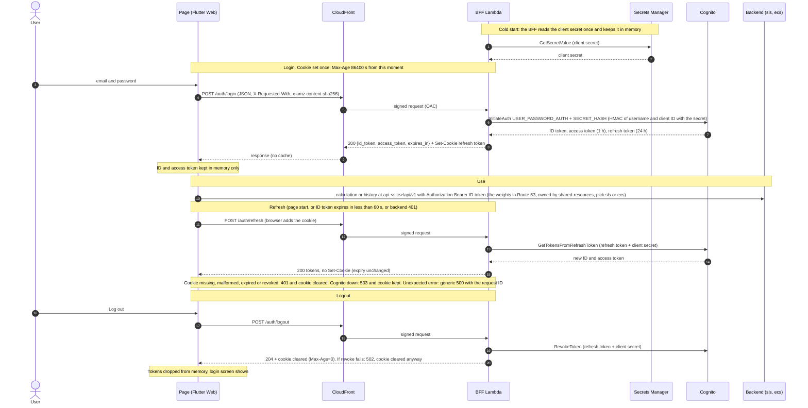

# Architecture

The calculator web page is a Flutter Web app served from S3 through CloudFront, in `dev` and `prod`. Each environment lives in its own AWS account, region `us-east-2` (the ACM certificate and the WAF scope are in `us-east-1`; CloudFront and Route 53 are global). The same compiled page is served in both.

Diagrams: AWS components in [`architect_components.drawio`](architect_components.drawio) (exported as `architect_components.png`) and layers in [`architect_layers.drawio`](architect_layers.drawio) (exported as `architect_layers.png`).

## What the BFF is and where it runs

The BFF (backend for frontend) is **an AWS Lambda function deployed by this repository** (`modules/auth-bff`, code in `src/auth_bff`). It runs **behind the page's CloudFront distribution**: CloudFront routes `/auth/*` to the function's function URL and everything else to the S3 bucket. It is **not code running inside CloudFront** (not a CloudFront Function and not Lambda@Edge).

Its only job is the session: login, refresh and logout against Amazon Cognito, keeping the long-lived refresh token in an `HttpOnly` cookie. It authenticates to Cognito as the confidential app client (the only app client bound to the BFF; the pool also has a public client for command-line tools, which the BFF refuses): the client secret lives in a Secrets Manager secret and the BFF reads it once at cold start (see [ADR 0004](adr/0004-confidential-app-client.md)). It is not a proxy: the page calls the chosen backend (sls, ecs, ...) directly with a bearer token, so the page stays shared between backends. Which backend answers is decided in Route 53 by the weighted records of the shared API hostname, owned by the repository `over-engineered-simple-calculator-shared-resources` (see [Shared API hostname](#shared-api-hostname)).

## Components

| Component | Where | Role |
|---|---|---|
| Flutter Web page | S3 bucket (private, OAC) via CloudFront | UI, session controller, API client. Keeps the ID and access tokens in memory only. |
| CloudFront distribution | global, custom domain with ACM certificate | Single public entry point. Default behavior to S3; ordered behavior `/auth/*` to the BFF, no cache. Security headers and CSP. |
| Shared WAF web ACL | existing, created outside this repository, **prod only** | Associated by ARN (`WAF_WEB_ACL_ARN`); covers the whole distribution. |
| BFF Lambda | this repo, us-east-2, Python 3.14, arm64, outside any VPC | Login, refresh, logout. Function URL with `AWS_IAM` authorization, reachable only through CloudFront (origin access control of type `lambda`). Execution role writes its own logs and reads one secret (the client secret); X-Ray in prod. |
| Cognito user pool + two app clients | this repo, us-east-2 | Local users created by the owner. Issues the tokens. The confidential client has a secret and is the one the BFF uses. The public client (no secret, spec 007) is for command-line tools and e2e tests of the `websocket` repository and is never used by the BFF; a direct password attempt against it does not pass through the BFF (gap G11). See [ADR 0009](adr/0009-one-app-client-per-client-type.md). |
| Secrets Manager secret | this repo, us-east-2 | Holds the app client secret (`sm-useast2-oecalc-auth-app-client-<env>`, AWS managed key, no rotation, TLS-only resource policy). Read by the BFF role only. |
| CloudWatch logs and alarms | us-east-2 | One JSON line per request; alarms on Errors and Throttles notify a dedicated SNS topic (us-east-2, email). |
| API hostname, certificate and weighted records | `over-engineered-simple-calculator-shared-resources` (not this repo) | `api.<web domain>`, its regional certificate, the weighted records and their expiry alarms. Moved there on 2026-10-07. |
| Backends (sls, ecs, ...) | other repositories | Answer the neutral path `/api/v1` on that hostname. Validate the ID token with the pool of their environment (`COGNITO_USER_POOL_ID`, `COGNITO_APP_CLIENT_ID`). |

## Trust boundaries

1. **Browser <-> CloudFront**: the internet. TLS 1.2 or later, HSTS, CSP. In prod the shared WAF filters requests first.
2. **CloudFront <-> BFF function URL**: CloudFront signs each request (SigV4, origin access control). Lambda refuses unsigned calls. The resource policy allows only the `cloudfront.amazonaws.com` principal with the source ARN of this environment's distribution (permissions `lambda:InvokeFunctionUrl` and `lambda:InvokeFunction`).
3. **BFF <-> Cognito**: public Cognito endpoints over TLS. The BFF calls `InitiateAuth`, `GetTokensFromRefreshToken` and `RevokeToken` without AWS credentials (unsigned), but authenticated as the confidential app client: `SECRET_HASH` at login and the client secret on renewal and revocation. Its role therefore has no Cognito permission, and a call without the secret is refused by Cognito (not yet verified in a deployed environment, task 6.6). "Unsigned" here does not mean unauthenticated.
3a. **BFF <-> Secrets Manager**: a normal signed call with the function role, once per cold start, to read the client secret (`secretsmanager:GetSecretValue` on that one secret). The secret stays in the memory of the function.
4. **Browser <-> backends**: a direct call to `https://api.<site>/api/v1` with `Authorization: Bearer <ID token>`; the BFF is not involved. The address is calculated from the page origin (read-only label), so a user cannot point the token elsewhere. The page sends the token only to `https` addresses (or `http://localhost` and `127.0.0.1` for a local build-time override).
5. **Account boundary**: `dev` and `prod` are separate accounts with separate pools, functions and distributions.

Passwords pass through the memory of the BFF during login and are never stored or logged.

## Where each token lives and how long it lasts

| Token | Lifetime | Lives in | Notes |
|---|---|---|---|
| Refresh token | 24 hours **from the login**, never extended | Cookie `__Secure-oecalc-refresh` (`HttpOnly; Secure; SameSite=Strict; Path=/auth`, `Max-Age=86400`) and Cognito | Set only by login. JavaScript cannot read it. Refresh never reissues it. Rotation is off. |
| ID token | 1 hour | Memory of the page | Sent as the bearer to the backends. Renewed when it expires in less than 60 seconds. |
| Access token | 1 hour | Memory of the page | Returned by the BFF; not used by the page for calls. |

Nothing is written to `localStorage`, `sessionStorage`, other cookies or logs.

## Flows

## Environments

| | dev | prod |
|---|---|---|
| Domain | `over-engineered-simple-calculator.dev.nube-segura.com` | `over-engineered-simple-calculator.nube-segura.com` |
| AWS account | its own | its own |
| WAF web ACL | none | existing shared one (`WAF_WEB_ACL_ARN`) |
| Cognito deletion protection | off | on |
| BFF log retention | 30 days | 365 days |
| BFF X-Ray tracing | off | active |
| CloudFront price class | `PriceClass_100` | `PriceClass_All` |

All differences are in `environments/<env>/env.hcl` (Terraform path) or `parameters/<env>.json` (CloudFormation path); the Terragrunt units are identical.

**Who owns each environment (2026-10-25).** One IaC tool owns an environment at a time, enforced by the owner guard ([ADR 0008](adr/0008-dual-iac-terraform-and-cloudformation.md)). `dev` is owned by CloudFormation/SAM (deployed 2026-10-24). `prod` is still owned by Terraform; its move is deferred to backlog item B003, and `IAC_TOOL` must be `terraform` in the `prod` GitHub environment before any merge to `main` (the default `cloudformation` makes the guard stop a prod deploy).

## Resource inventory

One row per resource (or group) created or changed by this repository. Name pattern: `<acronym>-<region>-<context>[-<descriptor>]-<env>` with `<region>` written without hyphens (`useast2`), `<context>` = `oecalc` and `<env>` = `dev` or `prod`. `<account-id>` is the AWS account of the environment. Rows describe the Terraform names; the CloudFormation path builds the same names (see the next subsection). Status: **new** = added by spec 001-cognito-auth-bff; **changed** = existed before and was modified; **kept** = pre-existing and unchanged by the spec. Every resource carries the mandatory tags from `environments/root.hcl` (`team-owner`, `project-name`, `app-name`, `repo-name`, `env-type`).

| Resource | IaC type | Real name (pattern) | Purpose | Env / dev vs prod | Status / cost note |
|---|---|---|---|---|---|
| Cognito user pool | `aws_cognito_user_pool` | `cgnp-useast2-oecalc-<env>` | Local users, tier `LITE`, email as username | dev and prod; deletion protection `INACTIVE` in dev, `ACTIVE` in prod | new; free within the free tier |
| Cognito app client (confidential) | `aws_cognito_user_pool_client` / `AWS::Cognito::UserPoolClient` | `cgnc-useast2-oecalc-<env>` | Confidential client (secret in Secrets Manager); consumed today only by the auth BFF, but not tied to the BFF by name (its scope may widen); its ID is the hand-off value `COGNITO_APP_CLIENT_ID`. `GenerateSecret` is create-only: changing it replaces the client and changes its ID | dev and prod, same | new (replaced when the secret was enabled, new client ID) |
| Cognito app client (public, websocket CLI, spec 007) | `aws_cognito_user_pool_client` / `AWS::Cognito::UserPoolClient` | `cgnc-useast2-oecalc-wscli-<env>` | Public client (no secret) for the websocket command-line tool and its e2e tests, named after that consumer; hand-off value `COGNITO_PUBLIC_APP_CLIENT_ID`; never used by the BFF (its refresh tokens are refused there); flows `ALLOW_USER_PASSWORD_AUTH` and `ALLOW_REFRESH_TOKEN_AUTH`, same validity, revocation and `PreventUserExistenceErrors` as the confidential client, no OAuth; output `PublicAppClientId` / `public_app_client_id` | dev now (CloudFormation); prod with the next Terraform deploy or B003 | new (spec 007); no charge |
| Client secret (Secrets Manager, spec 006, both tools) | `aws_secretsmanager_secret`, `aws_secretsmanager_secret_version`, `aws_secretsmanager_secret_policy` / `AWS::SecretsManager::Secret` (SecretString from the client `ClientSecret` attribute), `AWS::SecretsManager::ResourcePolicy` | `sm-useast2-oecalc-auth-app-client-<env>` | App client secret read by the BFF; AWS managed key (alias `aws/secretsmanager`), no rotation, no replica; resource policy denies non-TLS access, `BlockPublicPolicy` on; mandatory tags | dev and prod; Terraform recovery window 0 days in dev, 30 in prod (CloudFormation has no such property) | changed: replaced the SSM `SecureString` parameter `/oecalc/<env>/auth/app-client-secret` (removed); about 0.40 USD per month per environment |
| BFF Lambda function | `aws_lambda_function` | `fnc-useast2-oecalc-auth-bff-<env>` | Login, refresh, logout; Python 3.14, arm64, 256 MB, 10 s | dev and prod; X-Ray `PassThrough` in dev, `Active` in prod | new; pay per request, no reserved concurrency (ADR 0002) |
| Function URL | `aws_lambda_function_url` | generated host `<id>.lambda-url.us-east-2.on.aws` | Origin of CloudFront for `/auth/*`, `AWS_IAM` | dev and prod, same | new; no charge |
| Lambda permissions | `aws_lambda_permission` x2 | statement IDs `AllowCloudFrontInvokeFunctionUrl`, `AllowCloudFrontInvokeFunction` | Allow only this environment's distribution to invoke the function URL | dev and prod, same (in `modules/frontend`) | new |
| BFF execution role | `aws_iam_role` | `iamr-useast2-oecalc-auth-bff-<env>` | Lambda assume role | dev and prod, same | new |
| BFF role policy | `aws_iam_role_policy` | `iamp-useast2-oecalc-auth-bff-<env>` | Own logs, `secretsmanager:GetSecretValue` on the one secret (replaces `ssm:GetParameter`), X-Ray only when tracing is active | dev and prod; X-Ray statement only in prod | changed (spec 006) |
| BFF log group | `aws_cloudwatch_log_group` | `/aws/lambda/fnc-useast2-oecalc-auth-bff-<env>` | JSON request logs | retention 30 days in dev, 365 in prod | new; storage grows with retention |
| BFF SNS topic | `aws_sns_topic`, `aws_sns_topic_policy`, `aws_sns_topic_subscription` (email) | `sns-useast2-oecalc-auth-bff-alerts-<env>` (**us-east-2**) | Notifies the two alarms below; policy allows `cloudwatch.amazonaws.com` of this account and denies insecure transport | dev and prod, same | new; AWS managed encryption only (gap G8) |
| BFF alarms | `aws_cloudwatch_metric_alarm` x2 | `alrm-useast2-oecalc-auth-bff-errors-<env>`, `alrm-useast2-oecalc-auth-bff-throttles-<env>` | `Errors` and `Throttles` >= 1 in 5 minutes | dev and prod, same | new; standard alarm price each |
| Origin access control (BFF) | `aws_cloudfront_origin_access_control` (type `lambda`) | `oac-useast2-oecalc-auth-bff-<env>` | SigV4 signing of requests to the function URL | dev and prod, same | new; no charge |
| Origin access control (web) | `aws_cloudfront_origin_access_control` (type `s3`) | `oac-useast2-oecalc-web-<env>` | SigV4 signing of requests to the bucket | dev and prod, same | kept |
| Response headers policy | `aws_cloudfront_response_headers_policy` | `rhp-useast2-oecalc-web-<env>` | HSTS, nosniff, frame deny, referrer policy, CSP | dev and prod, same | changed (CSP added, applied to both behaviors) |
| CloudFront distribution | `aws_cloudfront_distribution` | Name tag `cfd-useast2-oecalc-web-<env>`; aliases `over-engineered-simple-calculator.dev.nube-segura.com` (dev), `over-engineered-simple-calculator.nube-segura.com` (prod) | Single entry point; origins `s3-web` and `lambda-auth-bff`; behavior `/auth/*` added | dev: `PriceClass_100`, no WAF; prod: `PriceClass_All`, shared WAF by ARN, plan fails if the ARN is empty | changed (second origin, ordered behavior, response headers policy). Requests to `/auth/*` are billed as uncached requests |
| Shared WAF web ACL | referenced by `web_acl_id` (not created here) | existing, passed as `WAF_WEB_ACL_ARN` | Filters the whole distribution | **prod only** | kept; owned outside this repository |
| S3 bucket and settings | `aws_s3_bucket` plus ownership controls, public access block, versioning, SSE (AES256), lifecycle, bucket policy | `bckt-useast2-oecalc-web-<env>-<account-id>` | Private bucket with the compiled page; read only by this distribution; TLS required | `force_destroy` true in dev, false in prod; noncurrent versions expire after 30 days | kept |
| ACM certificate and validation | `aws_acm_certificate`, `aws_acm_certificate_validation` (us-east-1) | Name tag `acm-useast2-oecalc-web-<env>` | TLS for the custom domain, DNS validated, RSA 2048 | dev and prod, domain differs | kept |
| Route 53 records | `aws_route53_record` (validation CNAME, `A` and `AAAA` alias) | the environment's domain name, in the hosted zone `<route53-zone-id>` of the account | DNS to CloudFront | dev and prod, domain differs | kept |
| Web alert topic and certificate alarms | `aws_sns_topic`, policy, email subscription, `aws_cloudwatch_metric_alarm` x2 (us-east-1) | `sns-useast1-oecalc-web-alerts-<env>`, `alrm-useast1-oecalc-web-cert-expiry-<N>d-<env>` with N = 30, 7 (two alarms, ACM-03) | Certificate expiry (ACM metric exists only in us-east-1) | dev and prod, same | kept |
| Terraform state | S3 bucket `bckt-useast2-tf-state-<env>-<account-id>` (outside this repository) | one state file per unit, key `over-engineered-simple-calculator-webpage/<env>/<unit path>/terraform.tfstate` (`edge/auth`, `edge/auth-bff`, `edge/frontend`) | Remote state with native locking; also holds the client secret in clear text (gap G10) | only while Terraform owns the environment (`IAC_TOOL=terraform`); not required in dev once CloudFormation owns it (the dev bucket does not exist, checked 2026-10-24) | kept |

### CloudFormation stacks (spec 006-cloudformation-sam-twin, `IAC_TOOL=cloudformation`)

The CloudFormation/SAM path builds **the same resources as the table above, with the same names, tags and settings**. Status: **deployed in dev on 2026-10-24** (all four stacks `CREATE_COMPLETE`, checked by the deployment verification); **prod stacks do not exist** and will not be created until backlog item B003. One tool owns an environment at a time (owner guard). Stack-level tags carry the five mandatory tags from `parameters/<env>.json`; the user pool also sets them in `UserPoolTags`. Order of deployment: auth -> cert -> auth-bff -> frontend; destroy (dev only) in reverse. Values between stacks are passed as parameters by `scripts/cfn_deploy.py` (no exports).

| Stack | IaC type | Name (dev deployed / prod not created) | Region | Template | Holds (rows of the table above) | Inputs from other stacks |
|---|---|---|---|---|---|---|
| auth | `AWS::CloudFormation::Stack` (plain CloudFormation) | `stk-useast2-oecalc-auth-dev` / `stk-useast2-oecalc-auth-prod` | us-east-2 | `templates/auth.yaml` | Cognito user pool, confidential app client, public app client (`PublicAppClientId` output), Secrets Manager secret and its resource policy | none |
| cert | `AWS::CloudFormation::Stack` (plain CloudFormation) | `stk-useast1-oecalc-cert-dev` / `stk-useast1-oecalc-cert-prod` | us-east-1 | `templates/cert.yaml` | ACM certificate and its DNS validation record, web alert topic, policy and subscription, two expiry alarms | none (zone ID and email from GitHub) |
| auth-bff | `AWS::CloudFormation::Stack` (SAM transform) | `stk-useast2-oecalc-auth-bff-dev` / `stk-useast2-oecalc-auth-bff-prod` | us-east-2 | `templates/auth-bff.yaml` | BFF function (secret name in an environment variable; no alias or versions), function URL, execution role and policy, log group, BFF SNS topic with its email subscription, two alarms | `AppClientId`, `ClientSecretName`, `ClientSecretArn` (auth) |
| frontend | `AWS::CloudFormation::Stack` (plain CloudFormation) | `stk-useast2-oecalc-frontend-dev` / `stk-useast2-oecalc-frontend-prod` | us-east-2 | `templates/frontend.yaml` | S3 bucket and settings, both OACs, response headers policy, distribution, two Lambda permissions, `A`/`AAAA` alias records | function name and URL host (auth-bff), certificate ARN (cert, cross-region) |

Additions that exist only on this path:

| Resource | IaC type | Name (pattern) | Purpose | Env | Status / cost note |
|---|---|---|---|---|---|
| Shared artifacts bucket | add-on template in `nube-segura-account-addons` (not this repository) | dev: `stk-useast2-addons-artifacts-dev` (stack) with the bucket name in SSM `/nube-segura/account-addons/artifacts/bucket-name`; the naming pattern for other environments is defined in the add-ons repository | Packaged BFF code and templates under the prefix `over-engineered-simple-calculator-webpage/<env>`; `samconfig.toml` uses `s3_bucket`, never `resolve_s3`. Retain policies, versioning, SSE, TLS-only, public access block; lifecycle per the S3 reference: Intelligent-Tiering, current objects kept, noncurrent versions 30 days in dev and 90 in prod, incomplete multipart uploads 7 days | dev and prod, us-east-2 (us-east-1 only if a template there exceeds 51,200 bytes) | prerequisite of every CloudFormation deploy; deployed in dev (us-east-2), **not deployed in prod** (needed by B003); owned and priced in the add-ons repository (cents, 0.023 USD per GB-month) |
| Stack termination protection and stack policy | stack settings (set by `cfn_deploy.py`) | - | Block a stack delete; deny `Update:Replace` and `Update:Delete` on the user pool, both app clients, secret, distribution and web bucket | prod only; implemented in `cfn_deploy.py` and `templates/stack-policy-prod.json`, never exercised because no prod stack exists | no charge |

Existing in the dev account, not used and not touched by this repository: the SAM managed stack `aws-sam-cli-managed-default` and its bucket, and `bckt-useast2-terraformation-artifacts-<account-id>-dev` (to inspect in their own repositories).

Removed from the state of this repository (spec 003-move-api-edge-out, not deleted in AWS; now owned by `over-engineered-simple-calculator-shared-resources`): the API certificate and its validation, the SSM parameter `/oecalc/<env>/api-certificate-arn`, the weighted API records, the weights guard, the API alert topic (policy and subscription) and the four API certificate expiry alarms. The pattern is in [`migrations/`](migrations/README.md). In the page, the API key field and header were replaced by the Cognito login (001) and the editable Service URL field by a read-only label (002).

### Known gaps in the inventory

- **CFD-13 (geo restriction):** the distribution has `restriction_type = "none"`. Accepted by the owner for now; it existed before this spec. Team default: a block list (CN, RU, KP, BY, IR, SY) in both environments.
- **CFD-05 (CloudFront logging):** the distribution has no standard or real-time logs. Accepted for now; it existed before this spec. Team rule: logging is required in prod.
- The BFF execution role is `iamr-useast2-oecalc-auth-bff-<env>` (renamed from `role-` in spec 006 to follow the current naming reference; the Terraform role is replaced if an environment already had the old one).
- Accepted gaps from the design review: G1 (local users, no federation, [ADR 0003](adr/0003-cognito-local-users-federation-gap-accepted.md)), G3 (log group without a customer managed key), G8 (SNS topic without a customer managed key), G9 (no permissions boundary), G10 (client secret in the state).

## Deployment units

`environments/<env>/edge/auth` (Cognito) -> `edge/auth-bff` (Lambda, alarms; needs the app client ID) -> `edge/frontend` (S3, CloudFront, certificate, DNS; needs the function name and URL host). Terragrunt orders them by dependency. The Lambda permission for CloudFront lives in `modules/frontend` because it needs the distribution ARN.

## Shared API hostname

`api.<web domain>` (for example `api.over-engineered-simple-calculator.dev.nube-segura.com` in dev) is **not owned by this repository any more**. Since 2026-10-07 the repository `over-engineered-simple-calculator-shared-resources` owns the hostname, its regional certificate (ARN in SSM `/oecalc/<env>/api-certificate-arn`), the weighted alias records, the weights and the certificate expiry alarms, and supersedes [ADR 0006](adr/0006-weights-owned-by-the-webpage-repository.md). All backends answer `/api/v1` ([ADR 0007](adr/0007-neutral-api-path.md)). A backend's record is created from shared-resources and changing weights never rebuilds the page.

What stays here: the page computes the read-only Service URL from its own host and sends the ID token to it; Cognito and the BFF issue the token. This repository forgot the moved resources with `removed` blocks (`destroy = false`), see [migrations](migrations/README.md).

## Error handling in the BFF

Expected failures map to 400, 401, 409, 429, 502 and 503. Any unexpected exception in the handler path becomes one logged record and a generic 500 with the request ID and no detail. The BFF never answers 403 or 404 (CloudFront turns both into the app page).

## Verified in dev and not yet verified

Checked against the dev environment on 2026-10-24 (read-only deployment verification) and 2026-10-25 (recorded e2e run): the four stacks and their tags, the user pool settings (admin-only users, tier `LITE`, deletion protection off in dev), the confidential app client, the public app client (checked 2026-10-25 after spec 007: no secret, two flows, expected validity, confidential client and pool unchanged, sign-in and wrong-password refusal, CloudTrail records, refresh token refused by the BFF), the Secrets Manager secret and the BFF role (log permissions and `GetSecretValue` on that one secret), the function URL answering 403 to an unsigned call, the Lambda resource policy limited to this distribution, the OAC behavior (`POST /auth/refresh` without a cookie answers 401 JSON through CloudFront), the security headers on live responses, the issued certificate, the sign-in with the `HttpOnly` `Secure` cookie, sign-out and the refusal of the closed session.

These items are built but have not been checked against a deployed environment:

- the Content Security Policy in a browser (no browser check of CSP violations was recorded);
- the email delivery of the BFF alarms (the dev subscription is `PendingConfirmation`);
- CloudFormation drift (not checked);
- everything about prod on the CloudFormation path (stacks, stack policy, termination protection, prod parameter rehearsal);
- the `boto3` version of the Lambda runtime (it must include `get_tokens_from_refresh_token`; otherwise boto3 must be packaged);
- whether the Cognito console can mark a new user's password as permanent;
- that Cognito refuses a direct `InitiateAuth` for the confidential client without the secret hash (task 6.6); the public client has no such protection by design.
- that the first deployment of each environment after spec 003 shows no changes for the moved resources (the `removed` blocks were applied only after shared-resources adopted them); tracked in the spec, not confirmed here.
